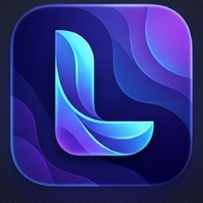
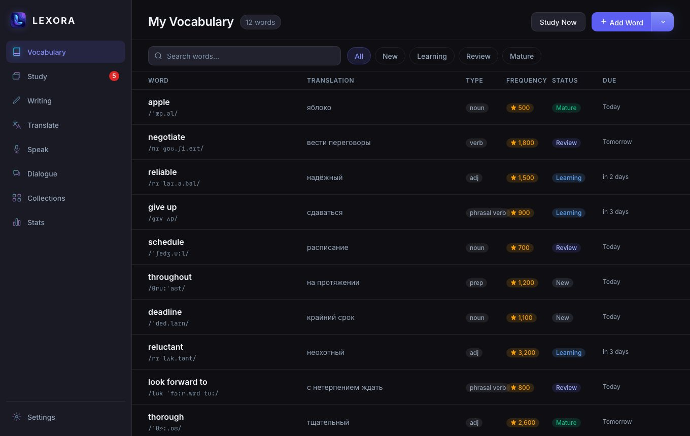
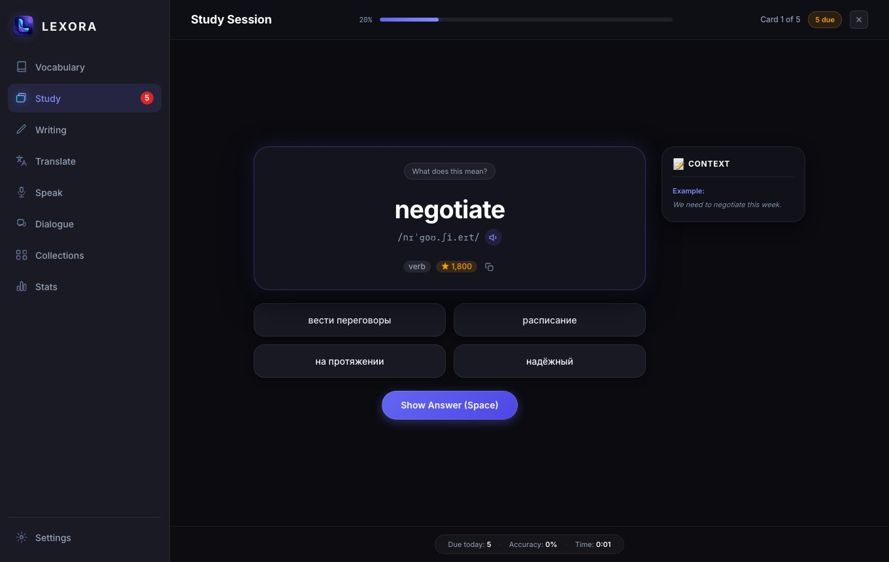
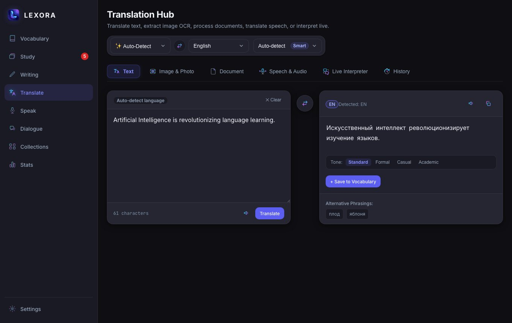
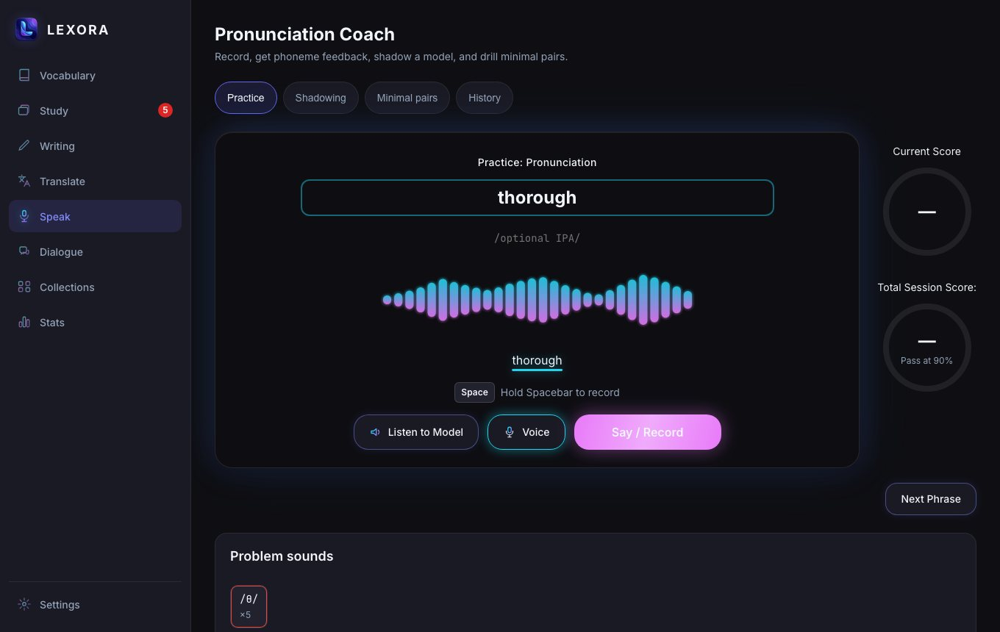
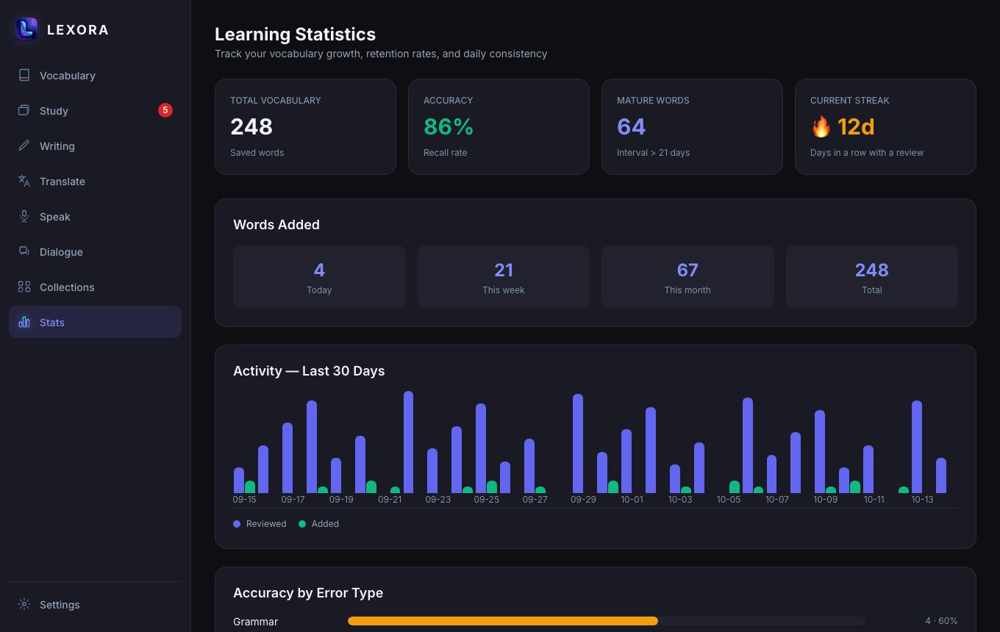

<div align="center">



# LEXORA

**Desktop-приложение для изучения языков с AI-ассистентом — local-first и приватное по умолчанию.**

[English](./README.md) · **Русский** · [Руководство пользователя (PDF)](./docs/user-guide/Lexora-User-Guide.pdf) · [EN](./docs/user-guide/Lexora-User-Guide.en.pdf)

</div>

Lexora помогает собрать личный словарь, повторять его по интервальному алгоритму (SM-2), писать и переводить тексты с AI, тренировать произношение и общаться с AI-репетитором. Словарь, повторения и статистика работают **полностью офлайн**; интернет нужен только для AI-функций.



## Возможности

| Раздел | Что делает |
|--------|-----------|
| **Vocabulary** | Личный словарь с поиском и фильтрами по статусу; добавление слов по одному, списком или файлом; карточка слова, заметки, произношение. |
| **Study** | Интервальные повторения SM-2, 8 режимов: карточки, ввод, слушание, пропуски, картинки, неправильные глаголы, определения, говорение. |
| **Writing** | Проверка грамматики / орфографии / стиля с объяснениями, переписывание (яснее, короче, формальнее, дружелюбнее…), упражнения на ваших типичных ошибках. |
| **Translate** | Текст, фото и картинки (перевод поверх изображения), документы и PDF, речь и аудио, синхронный переводчик, история. |
| **Speak** | Оценка произношения по фонемам, shadowing, минимальные пары, история. |
| **Dialogue** | Голосовые или текстовые ролевые сценарии с AI-репетитором и оценкой каждой реплики. |
| **Collections** | Готовые наборы (Top 5000, фразовые и неправильные глаголы, Business / Academic / Travel) и свои коллекции. |
| **Stats** | Рост словаря, точность, серия дней, активность за 30 дней, самые трудные слова. |
| **Popup-переводчик** | Перевод выделенного текста в любом приложении по глобальному хоткею. |
| **Стикеры** | Небольшие карточки поверх рабочего стола для фонового повторения. |
| **Проверка в других приложениях** | Бейдж с исправлениями «как Grammarly» в любом текстовом поле (macOS и Windows). |

<table>
<tr>
<td></td>
<td></td>
</tr>
<tr>
<td></td>
<td></td>
</tr>
</table>

## Принципы

1. **Local-first** — приложение полностью функционально без интернета (кроме AI-перевода).
2. **Privacy by design** — никакой аналитики и телеметрии. Данные остаются на вашем компьютере.
3. **No silent data loss** — транзакционные записи, проверка целостности при старте, автоматические копии, экспорт в JSON.
4. **Детерминированный SRS** — одни и те же ответы всегда дают одну и ту же дату следующего повторения.
5. **Progressive disclosure** — сложное скрыто за дополнительными действиями, основной сценарий — одно нажатие.

## Установка

| ОС | Артефакт |
|----|----------|
| macOS | `Lexora_<версия>_universal.dmg` (Intel + Apple Silicon; есть и отдельные сборки aarch64 / x64). Если Gatekeeper блокирует приложение — запустите `Разрешить Lexora.command` из DMG. |
| Windows | `Lexora_<версия>_x64-setup.exe` (NSIS, установка на пользователя, без прав администратора). |
| Linux | AppImage / deb (экспериментально). |

Релизы и подпись: [docs/release.md](./docs/release.md).

При первом запуске мастер настройки сам подберёт пакет AI-моделей (рекомендуется бесплатный ключ Google Gemini; можно и вовсе без ключей).

## Разработка

Требования: Node.js 18+, Rust stable, Xcode Command Line Tools (macOS).

```bash
npm install

npm run tauri dev             # запуск приложения (frontend + Rust backend)
bash scripts/install-mac.sh   # собрать и установить Lexora.app в /Applications (macOS, без DMG)
npm run typecheck             # tsc --noEmit
npm run lint                  # eslint, --max-warnings 0
npm run test                  # vitest
npm run test:e2e              # Playwright (мок Tauri IPC)
cd src-tauri && cargo test    # тесты Rust (SRS, репозитории)
```

### Стек

| Слой | Технология |
|------|-----------|
| Desktop shell | Tauri 2.x |
| Frontend | React 18 + TypeScript 5 (strict) |
| Стейт | Zustand 5 (UI) + TanStack Query v5 (серверное состояние) |
| Роутинг | React Router v6 (HashRouter) |
| Стили | Vanilla CSS + CSS Custom Properties (`src/styles/tokens.css`) |
| Backend | Rust (edition 2021) |
| База данных | SQLite через rusqlite |
| Сборка | Vite |

### Структура репозитория

```
src/            # React frontend
  pages/        # vocabulary, study, writing, translate, pronunciation, dialogue, collections, stats, settings
  components/   # ui/ (Button, Badge, ...) и domain-компоненты
  hooks/        # TanStack Query хуки
  stores/       # Zustand-сторы — только UI-состояние
  lib/          # ipc.ts (все invoke()), types.ts, constants.ts, utils.ts
  popup/        # Popup-переводчик (отдельная точка входа, popup.html)
  stickers/     # Desktop-стикеры (отдельная точка входа, sticker.html)
  grammar/      # бейдж и панель «проверки в других приложениях»
src-tauri/      # Rust backend: commands/, db/, providers/, srs/, hotkeys, tray
docs/           # заметки о релизах, аудиты, руководство пользователя
```

Правила разработки, стек и архитектурные решения зафиксированы в [AGENTS.md](./AGENTS.md) — конституции проекта. Перед любыми изменениями читайте её.

## Глобальные хоткеи и permissions

- **`CmdOrCtrl+Shift+L`** — перевести выделенный текст в любом приложении (открывает popup-переводчик).
- **`CmdOrCtrl+Shift+S`** — показать / скрыть стикеры.
- Для захвата выделения на macOS нужно разрешение **Accessibility**: System Settings → Privacy & Security → Accessibility → включить Lexora (при `npm run tauri dev` — бинарь `src-tauri/target/debug/lexora`, не приложение из `/Applications`). Без разрешения хоткей откроет popup, но выделенный текст может не попасть в поле перевода.
- Разрешение на микрофон нужно для Speak, Dialogue и перевода речи.

Хоткеи меняются в Settings → Global Shortcuts.

## Проверка текста в других приложениях («как Grammarly»)

Settings → **Writing check in other apps** (по умолчанию выключено; macOS и Windows):

- Lexora следит за текстовым полем, в котором вы печатаете. Через ~0,7 с после паузы текст уходит AI-провайдеру на проверку на изучаемом языке; в углу поля появляется бейдж с числом замечаний.
- Клик по бейджу → карточки с исправлениями; **Apply** меняет текст прямо в поле (сначала только изменённый фрагмент через Accessibility — сохраняются форматирование и undo приложения; если приложение не принимает запись — вставка через буфер обмена). Если вы успели изменить текст после проверки, исправление не применяется.
- Не читаются: поля паролей, поисковые поля, приложения из списка исключений (менеджеры паролей, терминалы, IDE — редактируется в настройках), тексты не на языке изучения. Проверки не сохраняются в БД.
- Нужно то же разрешение **Accessibility**, что и для хоткея.
- Код: `src-tauri/src/grammar_watch/` (наблюдатель, чистая логика в `logic.rs`), окно бейджа — `src/grammar/`.

## AI-провайдеры

Выберите пакет в Settings → AI-модели или настройте каждую роль вручную. API-ключи можно задать в UI (хранятся через `tauri-plugin-store`) или через переменные окружения:

| Провайдер | Переменные окружения | Поддержка аудио |
|-----------|---------------------|----------------|
| OpenAI | `OPENAI_API_KEY` | ✅ (Whisper API) |
| Google Gemini | `GEMINI_API_KEY` | ✅ (нативная) |
| Anthropic Claude | `ANTHROPIC_API_KEY` | ❌ (только текст) |
| Cloudflare Workers AI | `CLOUDFLARE_API_KEY`, `CLOUDFLARE_ACCOUNT_ID` | ❌ |
| OpenRouter | `OPENROUTER_API_KEY` | зависит от модели |
| Groq | `GROQ_API_KEY` | зависит от модели |
| Custom / Ollama | `CUSTOM_API_KEY` (опционально, для локальных моделей не нужен) | зависит от модели |

Для локальных моделей (Ollama, LM Studio) выберите провайдер `custom` и укажите OpenAI-compatible base URL (например, `http://localhost:11434/v1`).

## Документация

- [Руководство пользователя (PDF)](./docs/user-guide/Lexora-User-Guide.pdf) · [EN](./docs/user-guide/Lexora-User-Guide.en.pdf) — все экраны со скриншотами и настройка приложения.
- [Релиз и подпись](./docs/release.md)
- [AGENTS.md](./AGENTS.md) — конституция проекта.
