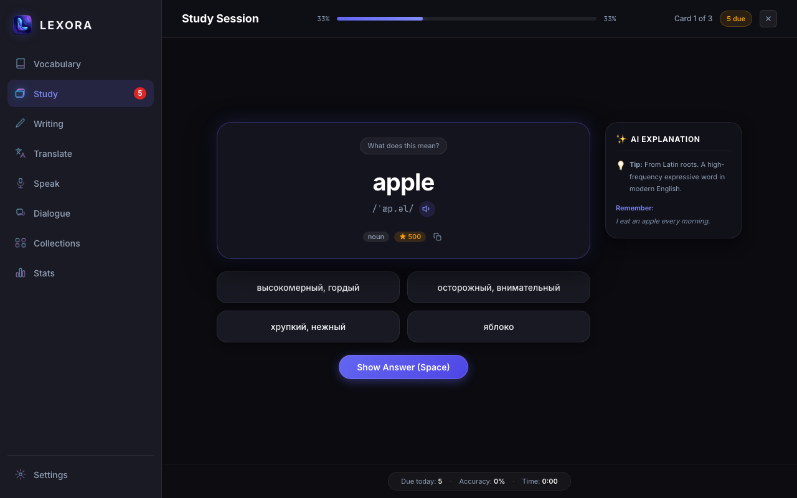
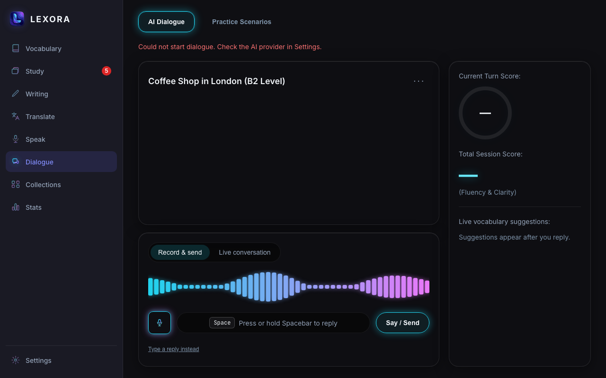
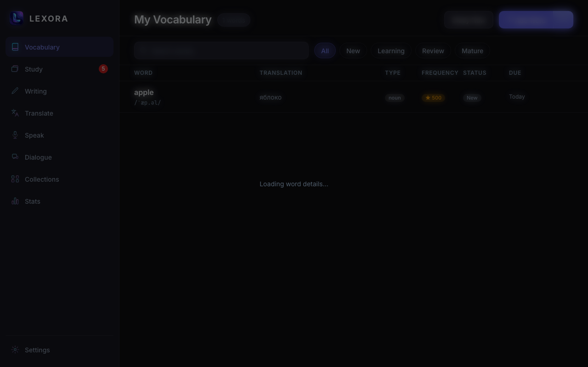
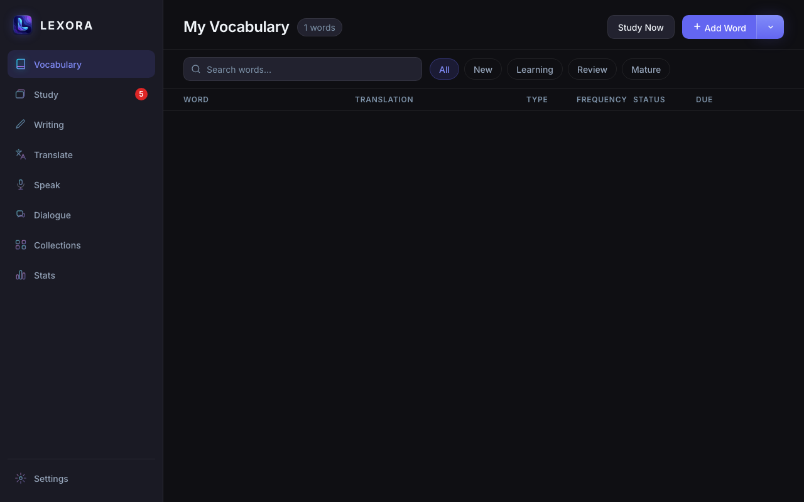
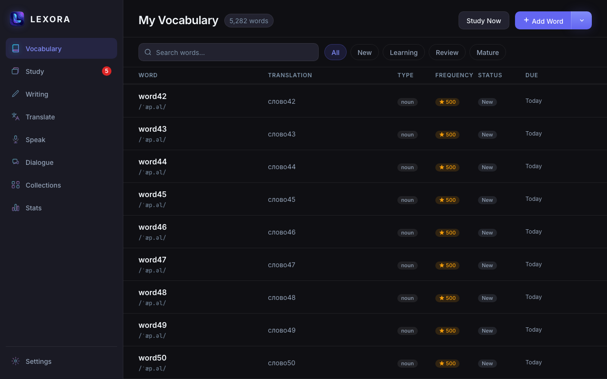
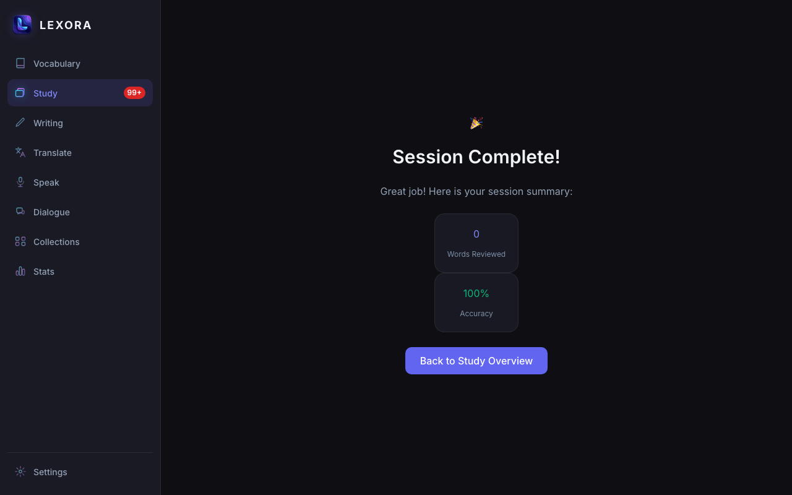
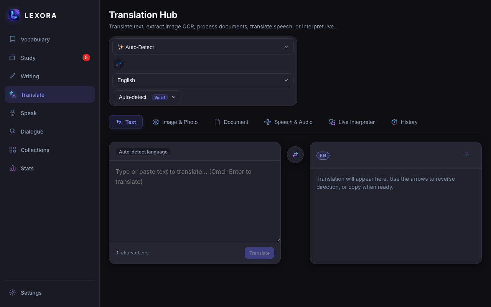
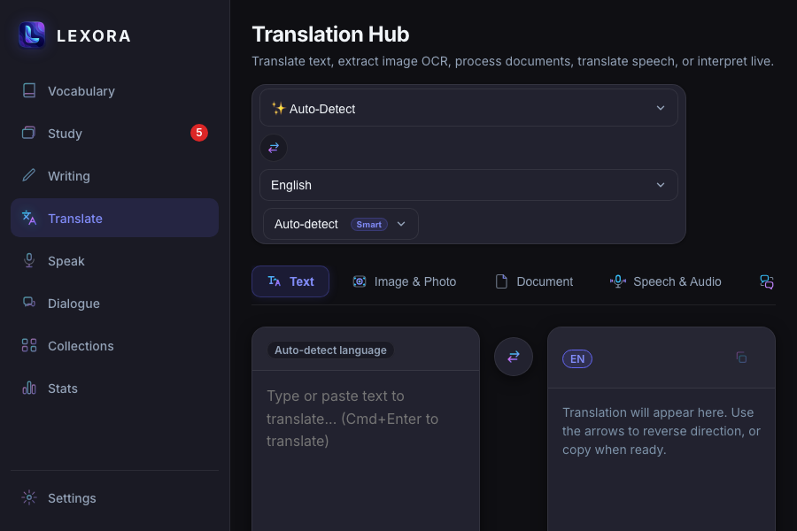
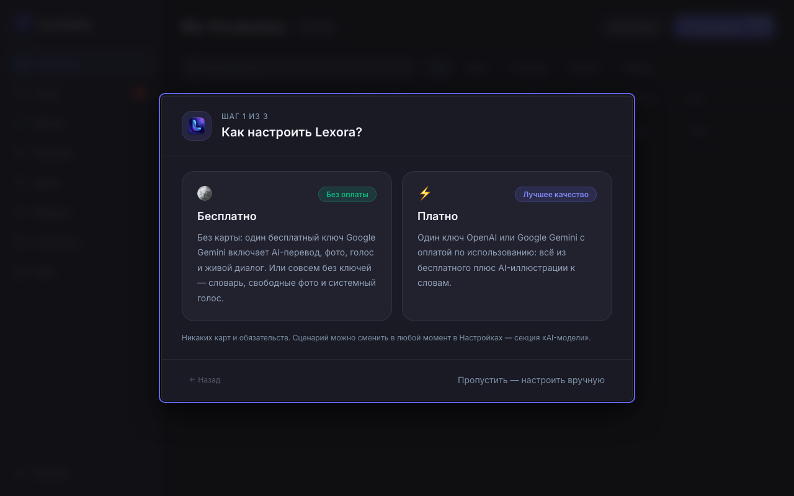

# Lexora — QA-отчёт: UI/UX и работоспособность (10.10.2026)

Режим: живое тестирование UI (Vite + мок Tauri IPC из `e2e/helpers/tauri-mock.ts`, Chromium через Playwright)
+ статические проверки. Продолжение [аудита от 03.10](./2026-10-03-lexora-audit.md): его пункты не пересказываются,
для них указана только актуальность.

Серьёзность: **S1** — падение окна, потеря данных/расписания, неограниченные вызовы AI; **S2** — заметный дефект основной
функции; **S3** — ограниченный дефект, a11y/UX; **S4** — косметика.
Статус: **Воспроизведено** (видел в работающем UI/тесте) · **Код** (подтверждено чтением кода) · **Авто** (результат автоаудита DOM).

## 0. Сводка проверок

| Проверка | Результат |
|---|---|
| `tsc --noEmit` | ✅ чисто |
| `npm run lint` | ❌ 25 проблем (24 ошибки, 1 предупреждение): `no-console`, `jsx-a11y/*`, `no-non-null-assertion`, `exhaustive-deps` |
| `vitest run` | 424 из 425. Упал `DocumentTranslateTab › dual-pane studio` по таймауту 5 с (шла сборка cargo — возможна нагрузка; не перепроверен). 4 теста, падавшие 03.10, починены |
| Playwright e2e проекта | **74 из 84** (03.10: 66 из 81). Все 10 падений — устаревшие селекторы; **обязательный сценарий «add word» (AGENTS §12) красный** |
| Живой прогон: 11 экранов × 1280×800 / 900×600 | JS-/console-ошибок нет; автоаудит DOM (имена, контраст, цели касания, переполнение) |
| ≈30 функциональных сценариев (одноразовые скрипты, удалены) | см. ниже |
| `cargo test` / `clippy` | ⚠️ **не проверялись** (сборка в песочнице падает на `libsqlite3-sys`, повторный запуск был остановлен) |

**Ограничения.** Нативное приложение, хоткеи, буфер обмена, системный TTS и реальные AI-провайдеры не проверялись; мок отдаёт
статичные ответы, поэтому поведение бэкенда оценивается по коду. Chromium ≠ WKWebView.

---

## 1. Критичные (S1)

### Q-S1-1. Flashcards (режим по умолчанию) не сохраняют оценки и показывают выдуманный контент — Воспроизведено (≡ S1-2, S2-8 от 03.10)
- **Где:** `src/pages/study/StudyPage.tsx:123`, `src/pages/study/modes/FlashcardMode.tsx`.
- **Факт:** три оценки подряд (Good/Easy/Forgot) → ни одного IPC-вызова (лог пуст), итог «3 Words Reviewed». `review_state` не меняется.
  Дистракторы — одни и те же три русские фразы для любого слова (даже для «Haus → house» и для карточки без перевода: «No translation»);
  интервалы «1d/2d/4d/8d» не связаны с SM-2; блок «AI Explanation» — захардкоженный «From Latin roots…».
- 

### Q-S1-2. «Dialogue»: шторм вызовов `start_dialogue_session` при ошибке — Воспроизведено (поднято с S2-16)
- **Где:** `src/pages/dialogue/DialoguePage.tsx:172–180`.
- **Факт:** при ошибке старта (нет ключа) экран аккуратно показывает «Could not start dialogue…», но за 5 с уходит **4 944** вызова
  (~1000/с) — эффект зависит от `startMutation.isPending`, после каждой неудачи снова срабатывает, флага «уже пробовали» нет. С реальным
  провайдером это шторм платных/лимитируемых запросов. На успешном старте тоже 5 вызовов вместо одного.
- 

### Q-S1-3. Popup превращается в пустое белое окно на «C++» и подобных — Воспроизведено (поднято с S2-15)
- **Где:** `src/popup/PopupTranslator.tsx:386` — `new RegExp(\`(${targetWord})\`)` без экранирования; `ErrorBoundary` в приложении нет ни в одном окне.
- **Факт:** слово `C++`, `(`, `[x`, `a\` и т. п. → `Invalid regular expression: /(C++)/gi` в рендере → React размонтирует всё окно, `#root` пуст.
  Выделенный через хоткей фрагмент кода легко содержит такие символы.
- 

---

## 2. Серьёзные (S2)

- **Q-S2-1. Карточка слова «вечно» грузится при ошибке** — Воспроизведено (≡ S2-17). `WordDetail.tsx:169`: «Loading word details…» навсегда, Esc не работает,
  сайдбар перекрыт; то же при deep-link `/#/vocabulary/9999`. 
- **Q-S2-2. Тихие отказы: нет состояния ошибки** — Воспроизведено. При сбое `list_vocabulary` — пустая таблица (заголовок всё ещё «1 words»), без сообщения и без
  empty-state; так же молча ведут себя Collections (`list_collections`) и Study (`get_study_queue`). Выглядит как «мои слова пропали».
  Stats и Settings ошибку показывают. 
- **Q-S2-3. Словарь показывает 50 слов из «5,282 words»** — Воспроизведено (≡ S2-3). `perPage: 50`, страница всегда 1, нет пагинации, нет кнопки удаления слова.
  
- **Q-S2-4. Ошибка «Add Word» в popup не показывается** — Воспроизведено (≡ S2-20). `addMutation.mutate` без `onError`: кнопка молча возвращается в «+ Add Word».
- **Q-S2-5. Study: пустая очередь и «зависающие» карточки** — Воспроизведено / Код. Пустая очередь → сразу «Session Complete! 0 Words, 100% Accuracy»;
  кнопка «Start Session (5282 words)» при лимите очереди 20; при `reviewState = null` режимы Typing/Listening/Cloze/Image/Irregular/Definition/Speaking
  шлют `reviewStateId: 0` (проверено на Typing) → NotFound без обработки. 
- **Q-S2-6. Деструктивные/дорогие действия без подтверждения** — Воспроизведено. «✓ Active in SRS» одним кликом шлёт `toggle_collection(active:false)`
  (по коду S3 от 03.10 это мягко удаляет слова коллекции); у кнопки нет `aria-pressed`/имени. «Load into database» всегда шлёт `withImages: true` без предупреждения о стоимости.
- **Q-S2-7. Translation Hub: сломанная раскладка** — Воспроизведено (≡ S3 от 03.10, но хуже). Языковая панель рассыпается в столбик уже на **1280×800**;
  при 900×600 вкладки «Live Interpreter» и «History» уходят за край (без индикатора прокрутки), поле ввода ниже сгиба.
   
- **Q-S2-8. Модальные диалоги и клавиатура** — Воспроизведено. Мастер первого запуска (`aria-modal`): Esc не закрывает, фокус уходит из диалога (22 из 25 Tab).
  Карточки режимов Study (`role="radio"`): Space не выбирает, стрелки не двигают выбор — работает только Enter. Skip-link нет (~10 Tab до контента).
  
- **Q-S2-9. Тестовый контур не охраняет приложение** — Воспроизведено. e2e «add word» (обязательный по AGENTS §12) ищет плейсхолдер «…in English…», а UI — «…in EN…»;
  ещё 6 падений — `page.getByLabelText` (нет в Playwright), переименованные кнопки/чекбоксы, `input#pron-shadow-target`; 1 — sticker «Не помню» (не разбирался).
  lint: 25 проблем при `--max-warnings 0`.

## 3. Средние (S3)

- **Q-S3-1.** Study на 1280×800: «Start Session» ниже сгиба (8 карточек режимов). Прогресс «33%» показывается дважды и уже на первой карточке.
- **Q-S3-2.** Кнопки оценки: `aria-label="Forgot (1 day interval)"` при видимом «Again» (WCAG 2.5.3 Label in Name), интервалы выдуманы.
- **Q-S3-3.** Popup: ранг частоты захардкожен — `FrequencyBadge rank={data.frequencyHint ? 4200 : 3241}` (мок `top-1000` → «★ 4,200»). Код + Воспроизведено.
- **Q-S3-4.** Смешение языков интерфейса: Settings (EN-заголовок + RU-панель «AI-модели»), мастер целиком на RU при интерфейсе `en`, sticker «Помню / Не помню» + «Later / Due now».
- **Q-S3-5.** Контраст (Авто): подсказка `⌘⇧L` в Settings — чёрный текст на тёмном фоне, **1.34:1**; текст 10 px («Smart», подсказка popup «Press ↵…»).
- **Q-S3-6.** Цели касания < 44×44 (AGENTS §10) по размеру *видимого* прямоугольника: чекбоксы Settings 16×16, кнопки sticker и крестик popup 22×22, иконки строк словаря 30×32, чипы фильтров 34 px, кнопки «Load…» 32 px. **Уточнение при исправлении:** для чекбоксов Settings, `btn--icon`, popup и sticker область нажатия уже расширена (`label min-height: 44px`, `::after`), так что это скорее ложное срабатывание автоаудита; реально остаются текстовые кнопки `sm/md` (32/38 px), чипы и вкладки.
- **Q-S3-7.** Статистика — заглушки (≡ S2-21): `streak: 1` в Rust, `get_daily_activity` → `[]`; карточка «Accuracy» показывала `100%` при отсутствии данных. Код. (Первоначальное утверждение «`Total` не приходит из бэкенда» неверно: `total` возвращается `get_words_added_stats`.)
- **Q-S3-8.** Popup: два подряд «Auto» (язык источника и непомеченный селектор домена), «Save bookmark» и «+ Add Word» делают одно и то же.

## 4. Мелкие (S4)
- «1 words» (нет склонения); белый на `#6366f1` = 4.47:1 (нужно ≥ 4.5; токен из AGENTS §5.1) — основной CTA по всему приложению;
- Google Fonts на каждый запуск каждого окна (AGENTS §0.1–0.2; CSP это разрешает);
- «✓ Active in SRS» выглядит как кнопка-действие, а не состояние; ссылка «Type a reply instead» 11–12 px, подчёркнутая, внизу;

## 5. Что работает хорошо
- Нет JS-/console-ошибок ни на одном из 11 экранов, `prefers-reduced-motion` снимает бесконечные анимации, навигация с клавиатуры в словаре видна (фокус-кольцо везде).
- XSS: HTML-пейлоады в ответе перевода (``, `<script>`) не исполняются (DOMPurify/React-экранирование).
- Длинный (4000 симв.) и RTL-ввод не ломает раскладку popup; неизвестные маршруты редиректятся.
- Pronunciation, Dialogue и мастер первого запуска оформлены последовательно; мастер помещается в 900×600.

## 6. Порядок исправлений (принят)
1. **S1:** Q-S1-1 → Q-S1-2 → Q-S1-3 (+ ErrorBoundary).
2. **S2:** Q-S2-1…Q-S2-9. 3. **S3 / S4** — быстрые правки (a11y-имена, радиогруппа, плюрализация, контраст), затем остальное.
Статус исправлений — в конце документа (раздел «Ход исправлений»).

## Приложение. Воспроизведения
Воспроизведения выполнялись одноразовыми Playwright-скриптами с моком Tauri IPC (журнал вызовов + автоаудит DOM); после исправлений
скрипты удалены, регрессии охраняют `e2e/` и vitest. Скриншоты — `docs/audit/img/`. Переопределения ответов IPC (`{ __error: '…' }`) —
как в `e2e/helpers/tauri-mock.ts`. Запуск — вне песочницы Cursor (Chromium падает с SIGSEGV внутри неё).

---

## Ход исправлений (10.10.2026)

Исправлено по северити S1 → S2 → S3/S4. Ничего не закоммичено — всё в рабочем дереве.

### Верификация

| Проверка | Результат |
|---|---|
| `tsc --noEmit` | чисто |
| `eslint` | чисто (до правок было 25 замечаний) |
| `vitest` | 75 файлов / 547 тестов — все зелёные |
| `cargo test` | 533 — все зелёные (в т.ч. 14 новых для статистики) |
| `cargo clippy` | 6 замечаний, все были до правок, в изменённых файлах нет |
| Playwright e2e | 87/87 (после починки селекторов, Q-S2-9) |

### S1

- **Q-S1-1 Flashcards.** Новая команда `submit_review` (атомарно через `ReviewRepo::process_review`, SM-2) + `ipc.study.submitReview` + хук `useSubmitReview`. Оценки сохраняются; варианты ответа строятся из реальных данных (`lib/flashcardOptions.ts`), выдуманные подписи интервалов убраны. Тесты: `FlashcardMode.test.tsx`, `flashcardOptions.test.ts`, Rust.
- **Q-S1-2 Dialogue.** Шторм `start_dialogue_session` остановлен (`autoStartAttempted`), при ошибке — сообщение и «Try again». Состояние «идёт запуск» хранится локально (`isStarting`), а не в `mutation.isPending`: в dev под React StrictMode наблюдатель мутации отваливается и `isPending` залипает в `true`.
- **Q-S1-3 Popup.** `splitByTerm` экранирует regex-символы («C++», «(», «[»). Добавлен `ErrorBoundary` (единственный class-компонент, исключение занесено в `AGENTS.md` §1) — окна больше не белеют.

### S2

- **Q-S2-1** WordDetail: состояния «ошибка» / «не найдено», закрытие по Esc.
- **Q-S2-2** Vocabulary / Collections / Study показывают ошибку с кнопкой повтора вместо пустого экрана.
- **Q-S2-3** Vocabulary: пагинация (`VocabularyPager`) и удаление слова с подтверждением (`WordDetailRemove`).
- **Q-S2-4** Popup «Add Word»: ошибка видна; ранг частоты — из данных, а не константа.
- **Q-S2-5** Study: честное состояние пустой очереди, корректный счётчик, `reviewStateId = 0` больше не уходит в бэкенд.
- **Q-S2-6** Collections: подтверждение при отключении коллекции; `withImages` по умолчанию `false`.
- **Q-S2-7** Translate: языковая панель переносится, а не рассыпается (1280 и 900 px); вкладки скроллятся с затуханием по краям.
- **Q-S2-8** A11y: мастер — Esc и focus trap (`useFocusTrap`), radio-карточки, skip-link.
- **Q-S2-9** e2e: обновлены селекторы в `01`, `02`, `05`, `09`; мок IPC дополнен `submit_review`.

### S3 / S4

- **Q-S3-1** Study: сетка режимов 4 колонки (3 при ≤1100 px), sticky «Start Session». (Дубль «33%» не трогали.)
- **Q-S3-2** Кнопки оценки: имя доступности совпадает с видимым текстом.
- **Q-S3-3** Popup: ранг частоты не захардкожен.
- **Q-S3-5** Контраст: `.settings-kbd`, мелкий текст 10–11 px → `--text-xs`, новые токены `--color-accent-text`, `--color-accent-solid` (≥ 4.5:1).
- **Q-S3-6** Расширена область нажатия у чипов-вариантов коллекций (`--touch-target-min`).
- **Q-S3-7** Статистика: реальная серия дней (`compute_streak`, с учётом локального часового пояса), `get_daily_activity` возвращает данные (индекс `V025`), пустое состояние, «—» вместо ложных 100%.
- **S4** «1 words» → `pluralize`; белый на акценте → `--color-accent-solid` (основной CTA).
- Попутно — lint: убраны `!` и вложенные интерактивные элементы, bbox-чипы изображения доступны с клавиатуры.

### Решения и компромиссы

- `ErrorBoundary` — единственное исключение из запрета на class-компоненты (согласовано).
- Статистика: если реально 0 % правильных ответов при ненулевом числе повторов — показывается «—» (крайний случай принят).
- Одноразовые QA-скрипты (`.qa-scratch/`) удалены.

### Не сделано (осознанно)

- **Q-S3-4** смешение RU/EN в интерфейсе — нужна договорённость о языке интерфейса / i18n.
- **Google Fonts** при каждом запуске — противоречит local-first; требует вендоринга шрифта Inter.
- **Q-S3-8** дубли в popup («Auto» ×2, «Save bookmark» vs «+ Add Word») — нужно продуктовое решение.
- Мелкие цели касания (< 44 px) у текстовых кнопок `sm/md`, чипов фильтров и вкладок.
